 

 

> [!TIP]
> 💼 **Open to opportunities:** Data Analyst • Business Analyst • MIS Analyst 
> ✈️ **Ready to relocate** for the right opportunity

 

## 👨‍💻 About Me

I'm a **Data Analyst** passionate about transforming raw data into meaningful business insights through **Power BI, SQL, Python, Advanced Excel, DAX and ETL Automation**.

Currently at **Smile Foundation**, I build interactive dashboards, automate reporting workflows and deliver KPI-driven insights for business decision making.

I enjoy solving business problems with data and keep exploring **Business Intelligence, Analytics and Automation**.

📍 **Location:** Gurugram, India 
🌐 **Portfolio:** [mohitojha13.github.io](https://mohitojha13.github.io) 
🔗 **LinkedIn:** [mohit-ojha-data-analyst](https://www.linkedin.com/in/mohit-ojha-data-analyst) 
📧 **Email:** [ojhamohit108@gmail.com](https://mail.google.com/mail/?view=cm&fs=1&to=ojhamohit108@gmail.com)

 

## 🎯 Core Expertise

<table width="100%">
<tr>
<td align="center" width="50%">📊 <b>Dashboards & BI</b></td>
<td align="center" width="50%">📈 <b>KPI Reporting & Visualization</b></td>
</tr>
<tr>
<td align="center">⚡ <b>ETL Automation</b></td>
<td align="center">🗄️ <b>SQL & Database Analysis</b></td>
</tr>
<tr>
<td align="center">🐍 <b>Python for Analysis & Automation</b></td>
<td align="center">📑 <b>Advanced Excel, Power Query & DAX</b></td>
</tr>
<tr>
<td align="center">🤝 <b>Data-driven Decision Making</b></td>
<td align="center">☁️ <b>Exploring ML & AI</b></td>
</tr>
</table>

 

## 🛠️ Tech Stack

<table>
<tr>
<td width="22%" valign="top"><b>Languages & Query</b></td>
<td>

</td>
</tr>
<tr>
<td valign="top"><b>BI & Visualization</b></td>
<td>

</td>
</tr>
<tr>
<td valign="top"><b>Data Analysis</b></td>
<td>

</td>
</tr>
<tr>
<td valign="top"><b>Database & Tools</b></td>
<td>

</td>
</tr>
</table>

 

## 📜 Certifications

 

## 🎯 Current Focus

<tr>
<td>

📊 Building interactive **Power BI Dashboards** 
⚡ Automating **ETL & Reporting Workflows** 
🐍 Improving **Advanced Python for Data Science** 
☁️ Exploring **Machine Learning, Deep Learning & AI**

</td>
</tr>

 

## ⚙️ How I Work

 

## 💼 Experience

<table>
<tr>
<td width="28%" valign="top">

**Data Analyst** 
Smile Foundation 
`Present`

</td>
<td valign="top">

Developing interactive dashboards, automating reporting workflows and turning business data into actionable insights using **Power BI, SQL, Python, Advanced Excel, DAX, Power Query, Tableau and Looker Studio**.

</td>
</tr>
<tr>
<td valign="top">

**MIS Executive** 
Greet India Foundation

</td>
<td valign="top">

Built MIS dashboards and templates, automated reporting and improved data verification, working in **Excel, Power BI and Google Sheets**.

</td>
</tr>
<tr>
<td valign="top">

**Data Analyst Intern**

</td>
<td valign="top">

Hands-on work in reporting automation, **SQL analysis**, exploratory data analysis (EDA) and business intelligence solutions.

</td>
</tr>
</table>

**Skills:** Power BI • SQL • Advanced Excel • Google Sheets • Google App Scripts • DAX • Python • ETL • Business Analysis • Data Analyst

 

## 🏆 Achievements

| Recognition | Details |
|---|---|
| 📈 **20+ Projects Completed** | Delivered dashboards, automation & reporting projects end-to-end |
| 💼 **2+ Years Experience** | Hands-on experience in data analysis & reporting roles |
| 📑 **50K+ Excel Rows Handled** | Cleaned, processed & analyzed large-scale datasets in Excel |
| 🏆 **10+ Certifications** | Certified in Power BI, SQL, Python & data analytics tools |
| ⭐ **5★ HackerRank SQL** | Achieved top rating for SQL problem-solving on HackerRank |
| 📊 **40% Report Time Reduced** | Designed & deployed interactive Power BI dashboards at Smile Foundation |
| ⚡ **30% Faster Data Delivery** | Automated ETL pipelines using Python & SQL at Smile Foundation |
| 🗂️ **25% Manual Reporting Time Cut** | Optimized MIS dashboards using Excel & Power BI at Greet India Foundation |
| 🎯 **25% Improved Reporting Accuracy** | Built new MIS templates & data verification techniques |
| 🎓 **300+ Students Trained** | Practical training in Excel, MS Office, Power BI & Google Sheets |

 

## 🐍 Contribution Snake

 

## 📌 Pinned Projects

> Explore my pinned repositories directly from my GitHub profile to see my latest **Power BI, SQL, Python, Excel, and Data Analytics** projects.

 

### ⭐ Thanks for visiting my profile!

If you like my work, feel free to ⭐ my repositories.

